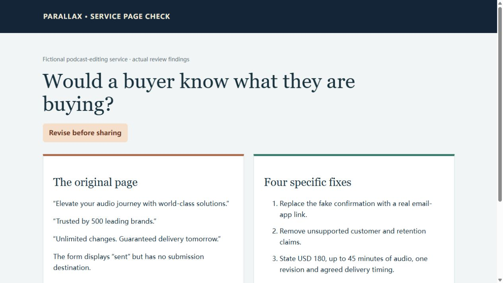
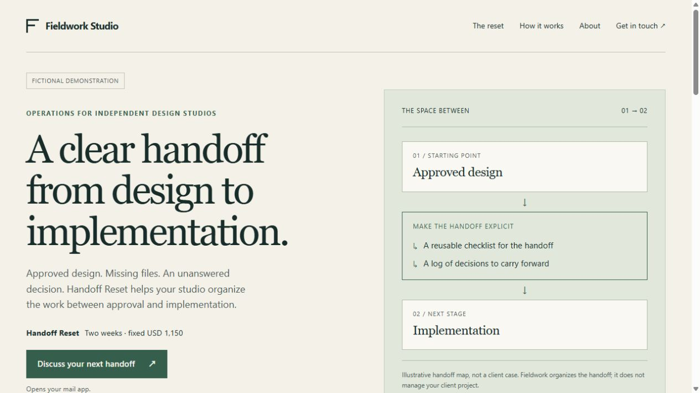
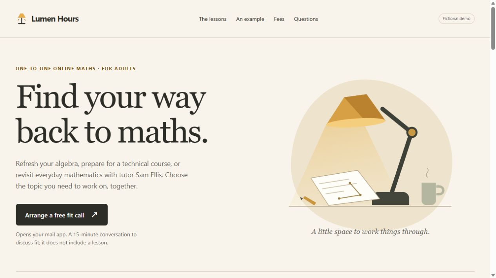

# Practical AI skills from Parallax

Reusable skills for independent professionals and small teams. Start with a real task, provide the facts, and get something you can inspect and use.

[Browse the Parallax skill collection on Agensi](https://www.agensi.io/creators/jam0731?utm_source=github&utm_medium=repository&utm_campaign=service-page-launch)

## A complete one-person company team

**Product decisions, development, marketing and quality review.** The four Parallax departments worked on one fictional business: they built a working capacity planner, wrote its launch material, found a product defect, repaired it and preserved the work for a later session.

[Open the actual team example](company-team-example/README.md) · [Download the generated planner](company-team-example/ledgerleaf-example.zip)

These are real outputs from a fictional local test. The full team is now available as **v1.1 of Parallax Client Delivery Team — USD 19 once**. [Open the approved Skill on Agensi](https://www.agensi.io/skills/parallax-client-delivery-team?utm_source=github&utm_medium=showcase&utm_campaign=service-page-launch). The marketplace still uses the Client Delivery Team name and earlier demo; the example above shows the expanded four-department workflow. The example is free to inspect and does not contain the paid Skill instructions.

## Start free: check your service page

**Parallax Service Page Check** reviews your copy or HTML for a clear offer, supported claims, practical scope and a contact step that does what it says. You get up to five concrete fixes, with replacement wording where your facts support it. It does not send messages or require a paid purchase.

[Try the free Skill on Agensi](https://www.agensi.io/skills/parallax-service-page-check?utm_source=github&utm_medium=showcase&utm_campaign=service-page-launch) · [Copy a first-use request](free-skills/parallax-service-page-check/README.md#start-with-your-page) · [See an actual review](examples/service-page-review.md)

On Agensi, choose **Copy prompt to install** and paste it into your AI assistant. Once connected, provide your page and the facts behind it. You can also [read the full Skill instructions](free-skills/parallax-service-page-check/SKILL.md) or install a project copy below.

Install just this Skill in a Codex project with the [Skills CLI](https://github.com/vercel-labs/skills):

```sh
npx skills add https://github.com/Jam0731/ParallaxAI/tree/main/showcase/free-skills/parallax-service-page-check --agent codex --skill parallax-service-page-check --copy
```

Run it from the project where you want the Skill. This command adds one Skill to that project, without installing the gateway or the repository's other skills. You can also copy the `SKILL.md` into a skill location supported by your assistant. It is also available free [on Agensi](https://www.agensi.io/skills/parallax-service-page-check?utm_source=github&utm_medium=showcase&utm_campaign=service-page-launch).



Try it with this request:

> Check this service page before I share it. Here is the copy and the facts I can support: [paste both]. Tell me what a buyer understands, the most important fixes and what still needs checking. Do not submit a form or send a message.

## See what a complete service page can look like

These pages were generated with **Parallax Service Page Builder** during local tests. They are complete, editable HTML files with their styling and original visuals included. Download a file and open it in a modern browser to inspect the result.

All business names, people, prices and contact addresses in these examples are fictional. They are demonstrations, not client work, testimonials or conversion results. The reserved example addresses do not accept real inquiries.

| Example | What it demonstrates | Actual HTML |
|---|---|---|
| Fieldwork Studio | A defined consulting offer, scope, price and email inquiry route | [HTML source and download](examples/fieldwork-studio.html) |
| Paper Kite | A useful draft when price, proof and contact details are not ready | [HTML source and download](examples/paper-kite-draft.html) |
| Lumen Hours | Adult tutoring, clear session pricing and a separate free fit call | [HTML source and download](examples/lumen-hours.html) |
| Zusammenarbeitswerkstatt | A German page comparing two workshop offers | [HTML source and download](examples/workshop-german.html) |





The accepted examples were checked in a local HTTP browser preview at desktop and phone widths, including a narrow layout with enlarged default text. Contact destinations and source facts were checked without sending inquiries. These checks are not a general accessibility certification or a guarantee of leads.

## Give your AI a useful brief

A polished page still needs real service facts. This free example lesson helps you write a six-field brief: buyer, deliverables, exclusions, known price and timing, permitted proof, and contact route.

[Open the lesson package](service-brief-workshop/README.md) · [Learner worksheet](service-brief-workshop/03_learner-worksheet.md) · [Instructor answer key](service-brief-workshop/04_instructor-key.md)

The package is an actual demonstration of **Parallax Course Pilot**. Its 12-minute duration is a planning estimate, not a recorded or rehearsed course. The learner worksheet and instructor answer key are separate.

## Choosing a skill

- **Write short videos from source material:** [read the full Source-to-Shorts example](source-to-shorts/README.md), including the brief, three spoken scripts and filming notes.
- **Check a page:** start with the free Service Page Check above.
- **Build the actual page:** [Service Page Builder](https://www.agensi.io/skills/parallax-service-page-builder?utm_source=github&utm_medium=showcase&utm_campaign=service-page-launch) is available for USD 14 once. Inspect its four actual output examples above before buying.
- **Prepare a lesson:** [Course Pilot](https://www.agensi.io/skills/parallax-course-pilot?utm_source=github&utm_medium=showcase&utm_campaign=service-page-launch) produces teaching text, a worked example, learner practice and a separate answer key.
- **Clarify the service:** [Offer Stress Test](https://www.agensi.io/skills/parallax-offer-stress-test?utm_source=github&utm_medium=showcase&utm_campaign=service-page-launch) helps work through scope, effort and price assumptions before making a promise to a client.

Each listing states its current price, required host capabilities and limits. AI service fees and hosting are separate. The open-source collaboration gateway in this repository and the commercial skill collection are separate products.

The free Skill and examples in this directory are covered by the repository's [MIT license](../LICENSE). Commercial Skill instructions are distributed through their marketplace listings.
