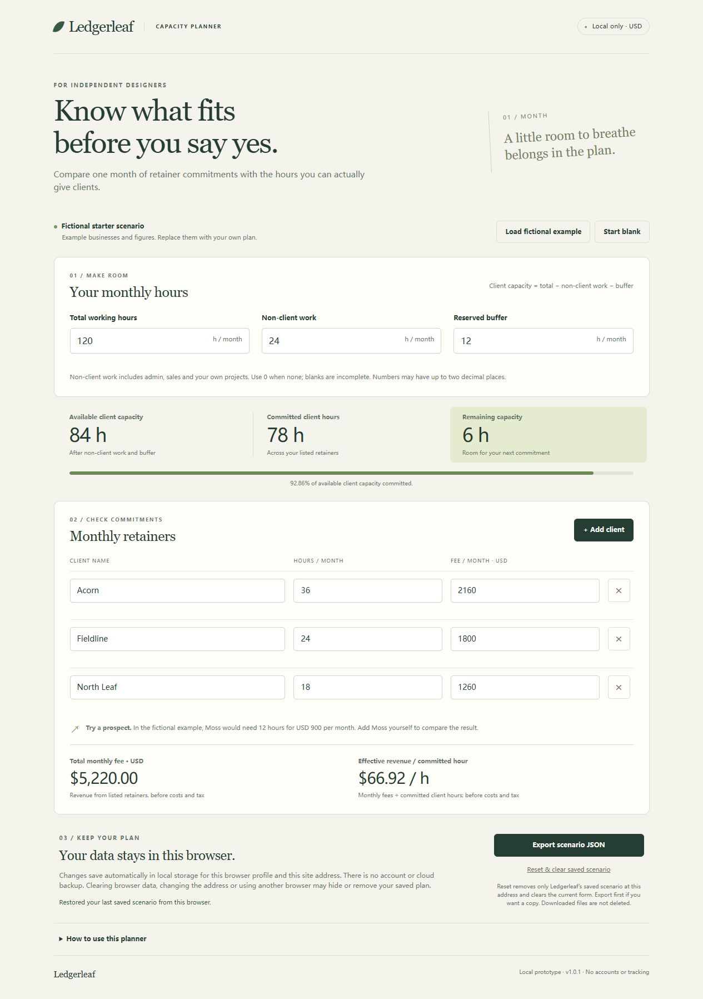

# A one-person business, from idea to working product

A fictional business called Ledgerleaf used Parallax One-Person Company to decide what to build, make a working retainer-capacity planner, prepare its launch and review the result. These are selected actual outputs from that local Skill trial, not customer work or a measured business success.

| Business work | What this run produced | Open the actual work |
|---|---|---|
| Product decisions | A product and offer decision for independent designers, with assumptions and limits | [Product brief](departments/munger/product-offer-brief.md) |
| Development and delivery | A responsive working planner with calculations, validation, browser persistence and JSON export | [Application files](product/) |
| Marketing and launch | Finished landing-page copy, three posts, an opt-in email draft and a measurable test plan | [Landing copy](departments/ogilvy/landing-page.md) · [Posts](departments/ogilvy/launch-posts.md) · [Email](departments/ogilvy/opt-in-follow-up-email.md) |
| Quality and improvement | Actual artifact review, recomputed costs and a saved-status defect returned for repair and rechecked | [Review](departments/taleb/review.md) |

[Read the original request](input.md) · [Company record](company-example.json) · [Experiment](departments/ogilvy/acquisition-experiment.md) · [Blank measurement log](departments/ogilvy/measurement-log.csv)

## Try the generated example

[Download the generated example](ledgerleaf-example.zip), or take the five files in `product/`. Serve that folder with a local static HTTP server and open its local address in a modern browser. The files use no external libraries, account, backend or application network API. The browser stores the scenario for that local address; export a JSON copy if you want to retain it separately.

The supplied example shows 84 available client hours, 78 committed and 6 remaining. Adding the fictional Moss prospect makes it 6 hours over capacity. All names, fees and business details are fictional.

This is the frozen v1.0.1 example from the original request. Later continuation tests are separate; this page does not represent a product sold by Ledgerleaf or an active experiment.

## What was checked

The engineering pass executed calculation and validation checks. A separate Taleb worker reviewed actual code, browser behavior, marketing claims and cost arithmetic. It found a persistence-status message that could falsely suggest a save had succeeded; Woz repaired it, and Taleb rechecked the affected paths. Reviews and code hashes identify the inspected version. Detailed evaluator-only test files referenced in the review remain in the private validation archive.

The lead worker handled Munger and Woz passes; Ogilvy and Taleb each used a separate worker. This run does not demonstrate four simultaneous background processes. No customer was contacted, no paid service was bought, and no sale or customer outcome was measured.

## Use Parallax One-Person Company

[Get Parallax One-Person Company on Agensi — USD 19 once](https://www.agensi.io/skills/parallax-one-person-company?utm_source=github&utm_medium=example&utm_campaign=service-page-launch). The latest approved package is v1.1, verified on 21 October 2026. The product page shows the business workflow and actual application demo.

After installing the Skill in your assistant, start with:

> Use Parallax One-Person Company v1.1. My business goal is [goal]. Here are my customers, current materials and constraints: [facts]. Decide priorities, produce the working deliverable, prepare the marketing work, inspect the actual results and fix any issues. Save the company records so we can continue later. For this first task, work locally and keep public posting, messages and spending as proposals.

You can also address one department directly, such as **@woz** to implement a change or **@ogilvy** to prepare launch material. The assistant's tools determine which actions it can execute; separate workers are used when the host supports them. Model usage and hosting are separate.

[Back to Parallax examples](../README.md).
